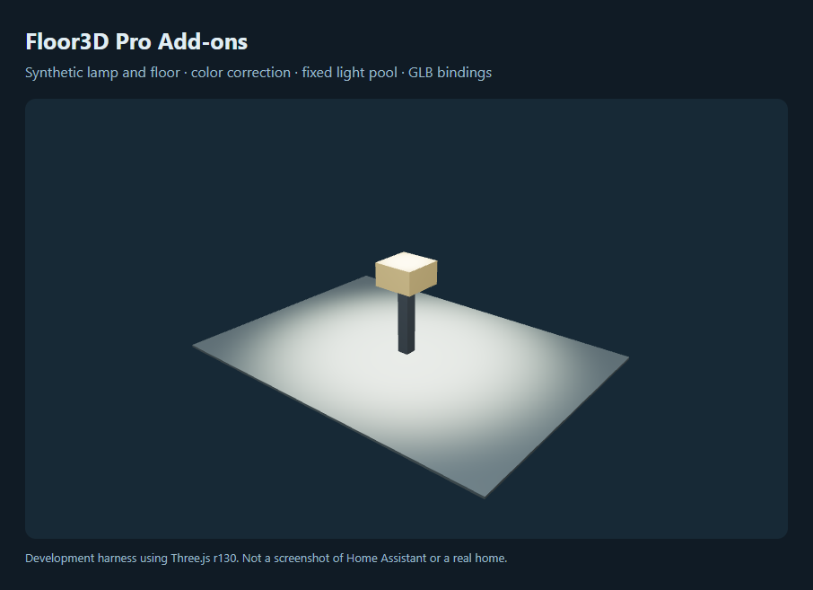

# Floor3D Pro Add-ons

Optional rendering improvements and GLB compatibility fixes for
[Floor3D Pro Card](https://github.com/levonisyas/floor3dpro-card).
Install the native card separately; this package is a companion, not a replacement.



The image uses a generated lamp and floor in a development harness. It is not a
Home Assistant screenshot, a real home's model, or a before/after performance claim.

## Features

- Opt-in sRGB output, ACES filmic tone mapping, exposure, ambient and torch controls.
- A generated sky/ground environment when a usable model texture is available.
- A fixed spot/point light pool that keeps light counts and shadow flags stable as
  fixtures switch on and off. Nearby compatible lights merge when capacity is tight;
  omitted lights are reported rather than silently hidden.
- Optional off-light culling, entity-change render filtering, state-render throttling,
  pixel-ratio control and mesh-shadow control for low-power panels.
- GLB multi-material hierarchy repair and clicks on an unbound light primitive
  resolved to its configured light ancestor. Explicit child bindings take precedence.

## Compatibility and limits

Initial target: **Floor3D Pro `1.5.3-Pro.Faz.2.1` with Three.js r130**. The package
checks the required internal methods before patching, and rendering changes are
skipped on incompatible color-management APIs. It does not claim compatibility
with every fork or future version; private methods can change without notice.

Rendering changes require `render_upgrade`. Cards without it and native
`sky: "yes"` cards keep their rendering settings. GLB repair is enabled by default
and can be disabled with `glb_hierarchy_fix: false`; OBJ hierarchy/click behavior is
unchanged. Light-pool fitting assumes centimetre model coordinates and approximates
lighting when it merges or drops fixtures. GPU/browser speedups are not guaranteed.

The add-on does not connect to HA, call its services directly, fetch external
assets, or send telemetry. Clicks still invoke the native card's configured actions.
No household model, live dashboard, cameras, credentials, or device codes are shipped.

## Install

The add-on is not in the default community catalog, so it is added by link.

1. Install the supported **Floor3D Pro Card** separately.
2. Open **Settings → Marketplace**, select **Add from link** and enter
   `https://github.com/EndOfTheLine-HA/floor3d-pro-addons`. Choose **Dashboard**
   if asked (HACS validation calls this category `plugin`), then install
   **Floor3D Pro Add-ons**. Add from link needs a GitHub connection.
3. Under **Settings → Dashboards → Resources**, confirm that one JavaScript module
   resource for `floor3d-pro-addons.js` exists. Add it yourself only if the install
   did not register one.
4. Remove any separately registered legacy render-upgrade and GLB-hierarchy-fix
   resources. Do not load them alongside this bundle.
5. Fully reload the browser/dashboard. If the console says the card was configured
   before the add-on loaded, check resource loading/order and reload again.
6. Start with a test dashboard and enable `render_upgrade` on one card.

Before Home Assistant 2026.11, add the repository to HACS as a custom repository of
type **Dashboard**, download it, and check for the resource
`/hacsfiles/floor3d-pro-addons/floor3d-pro-addons.js`.

This is a frontend resource, not an integration under **Devices & services**. It
does not require a Home Assistant backend restart. Browser caching may require a
hard reload after updating. Adding it by link is separate from inclusion in the
default community catalog.

## Configure

Keep your existing native card configuration, model path, entities and object IDs.
For color/lighting correction only, add:

```yaml
render_upgrade: "yes"
```

For a configurable fixed light pool:

```yaml
render_upgrade:
  exposure: 1.6
  ambient: 0.1
  torch: 0.3
  light_pool:
    spots: 14
    points: 2
    shadows: 6
    point_shadows: true
```

All settings, bounds, tradeoffs and a low-power example are in
[configuration](docs/configuration.md). Try the small, entirely synthetic
[demo model and card configuration](examples/README.md) without publishing your model.

### Migrating from the private scripts

This focused first release is **not** a drop-in replacement for every legacy
option. Night rendering, TV screens, decals, wall/fixture glow, lift/merge tags,
per-user overrides and resize freezing are not ported in v0.1.0. Unknown options
produce a configuration error rather than being silently ignored. See
[migration and rollback](docs/migration.md) before changing an existing dashboard.
The Blender/model-conversion pipeline is a separate project and is not included.

## Development and validation

Node.js 22 or newer:

```sh
npm ci
npm run build
npm run verify
npx playwright install chromium
npm run test:browser
```

The HACS-ready artifact is committed at `dist/floor3d-pro-addons.js`; no build
tools or separate Three.js download are needed on the user's HA instance. The
bundle has no runtime dependencies. Tests use Three.js r130 and synthetic fixtures.
The browser smoke test uses a minimal native-card contract with real GLTFLoader
and WebGL, **not** a running HA instance. Chrome on Windows is detected automatically;
otherwise Playwright's Chromium must be installed, or set
`PLAYWRIGHT_CHROMIUM_EXECUTABLE` to a compatible browser binary.

[AUDIT.md](AUDIT.md) distinguishes automated validation from remaining live
acceptance. CI includes official HACS plugin validation; local packaging checks
do not substitute for that remote validation. No live deployment or public
publication is performed by these scripts.

MIT. See [LICENSE](LICENSE) and [NOTICE](NOTICE) for attribution and upstream lineage.
